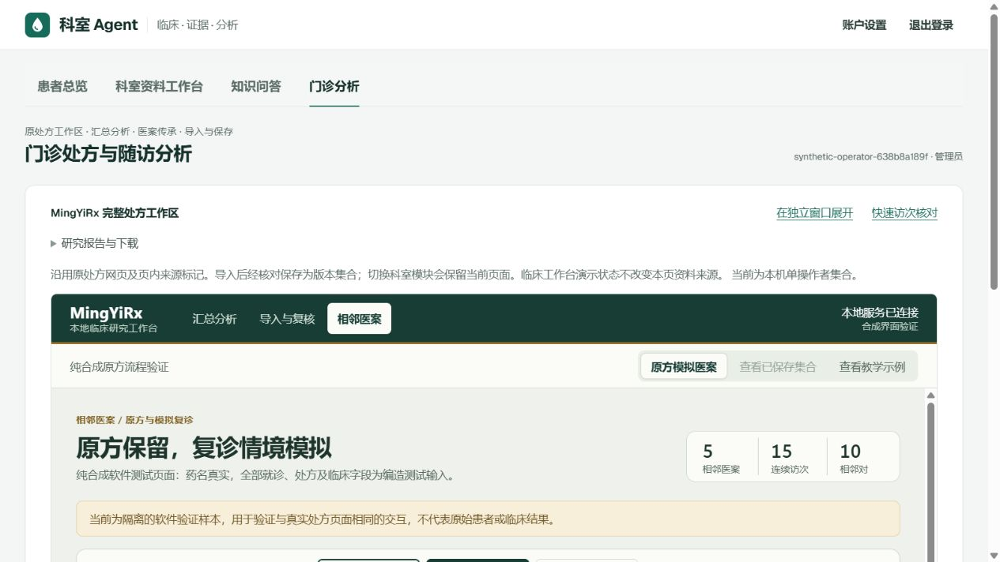

# Department Agent

A local workbench for clinical document review, evidence provenance and longitudinal prescription analysis. The interface is in simplified Chinese. This repository brings the clinical workbench, the knowledge module and MingYiRx into one session-protected application.

**The default installation is a synthetic software demonstration.** It uses fictional records, a synthetic FHIR service and a deterministic knowledge example. It does not run real clinical OCR/model extraction or connect to a production Medplum server by default. Software checks do not establish clinical accuracy.



## Start locally

Requirements: Git, Python 3.11 or newer, and [uv](https://docs.astral.sh/uv/). The default demonstration requires no GPU, Docker, model download or external API key. Dependency installation requires access to the package index.

```sh
git clone https://github.com/KR0817/department-agent.git
cd department-agent
uv sync --frozen
uv run --frozen python scripts/start.py
```

Open **http://127.0.0.1:18894/#overview**. Keep the terminal open; Ctrl+C stops only the two services started by that launcher. Windows users may run `./Start-Department-Agent.ps1` after `uv sync --frozen`.

The first start builds all 14 prescription assets from invented inputs. Generated pages, SQLite stores, collections and logs stay in ignored `work/` directories. The default run name is `default`: restarting it resumes its local synthetic state. An OS lock prevents two launchers from using that run concurrently. Use `--run-name example2` for a separate run, or `--port 18896 --fhir-port 18897` when the default ports are occupied. Both services bind only to `127.0.0.1`.

Use a Git clone. The prescription module deliberately checks that writable output is Git-ignored; the launcher does not bypass this safeguard for a downloaded ZIP.

## Included workflows

| Module | Public demonstration | Preserved implementation |
|---|---|---|
| Clinical workbench | Register a fictional patient, upload marked synthetic CSV, review source lines, confirm and archive, reopen a longitudinal record | Field-level provenance, review/edit/reject/defer decisions, corrections, versioned archival/recovery, patient overview, follow-up queues, account/recovery code |
| Knowledge | Read an explicitly synthetic source and ask its example question; unrelated questions are refused | Source-bound extractive answers, source/section locators, provenance checks, translation labels and the optional frozen-corpus/model path |
| Prescriptions | Aggregate, exact prescription and inheritance views; recognize, review, save and resume invented collections; synthetic report/download pages | Complete MingYiRx source, analysis and rendering modules, input validation, per-collection revision handling and separate source labels |

The clinical schema currently defines 19 field types. Declaration of a field does not imply that a document contains it or that a model extracts it accurately. Clinical and prescription identity scopes remain separate. Follow-up messages are queued locally, not sent to patients. The risk and cohort examples are explicitly synthetic.

The default clinical workflow accepts `SJD-SYNTHETIC` CSV examples through deterministic parsing. The clinical source also contains OCR, local-model and FHIR integration paths; those paths require separate configuration and validation. No diagnosis or prescription is automatically approved by the model.

The prescription report and its report CSVs contain clearly labeled fictional display values and fictional document identifiers. The aggregate, clinical shell, exact-prescription and inheritance views reuse the existing renderers. The synthetic report is a functional demonstration, not a reproduction of private study results or a medical evidence review.

## Verify

```sh
uv run --frozen python scripts/start.py --prepare-only
uv run --frozen python scripts/check.py
uv run --frozen python scripts/smoke_test.py
uv run --frozen python scripts/release_check.py
```

`check.py` runs the portable unit suites. `smoke_test.py` starts separate loopback services, checks the integrated synthetic workflows and stops only its owned processes. It never invokes a model. `release_check.py` inspects the Git index for prohibited files and known unsafe patterns without printing matched values. The scanner is one publication control; it cannot certify that arbitrary contributed data is anonymous.

For the optional browser regression, start an isolated synthetic run on ports 18930/18931 and run `node scripts/ui_check.cjs` with Playwright available to Node and Microsoft Edge installed. `PLAYWRIGHT_MODULE` may point to an existing Playwright installation. `UI_CHECK_BASE`, `UI_CHECK_OUTPUT` and `UI_CHECK_CHANNEL` override the loopback URL, ignored evidence directory and browser channel. The check creates explicitly synthetic records and captures desktop, tablet and mobile screens. Use a dedicated run; never point it at a business deployment.

The workbench UI uses a responsive navigation rail, source comparison and the complete original prescription workspace. See [the UI implementation contract](docs/UI-Optimization-Tech-Spec.md) for preserved behavior and acceptance criteria.

## Optional local literature mode

The original literature collection, PDFs, full-text XML, translations and frozen indexes are **not distributed**. The repository's software license does not grant rights to them. Supply a local, validated corpus you are entitled to use, preserving the source module's required provenance and index layout:

```sh
uv run --frozen python scripts/start.py --knowledge-mode fulltext --knowledge-root /path/to/validated/knowledge-project
```

See [knowledge/README.md](knowledge/README.md) for the existing index contract and transport requirements. This mode is optional and is not exercised by the offline demo checks. The existing real-model transport targets a local Docker setup; operating-system, model, GPU and image configuration must be verified separately. Model weights and Docker image archives are not in this repository.

Do not put patient records into the public-literature workflow. Clinical imports and real deployments need their own institution-approved controls and validation; the synthetic launcher is not a hospital deployment recipe.

## Repository layout

```text
clinical/       FastAPI host, review workflows, adapters, optimized UI, synthetic fixtures
knowledge/      Knowledge engine source and explicit synthetic demonstration
prescription/   MingYiRx source, tests and approved synthetic inputs
scripts/        Portable preparation, launch, testing and release checks
licenses/       Preserved upstream notices
work/           Ignored local run data and test artifacts
```

This is a fresh source-only distribution. It includes no private project history, real clinical exports, private derived reports, account stores, credentials, deployment snapshots or personal filesystem paths. The existing local deployments and backups are separate.

## License and contributions

The integrated application is **AGPL-3.0-only** because it incorporates AGPL ClinData Relay code. MingYiRx and ThreeUI notices and the Geist OFL remain in effect for their components; see [THIRD_PARTY_NOTICES.md](THIRD_PARTY_NOTICES.md). The UI includes a source link for this release. When serving a modified version, keep that link aligned with the version actually served and comply with the applicable license terms.

See [CONTRIBUTING.md](CONTRIBUTING.md) and [SECURITY.md](SECURITY.md). Keep reported issues and pull requests free of patient information and secrets.
